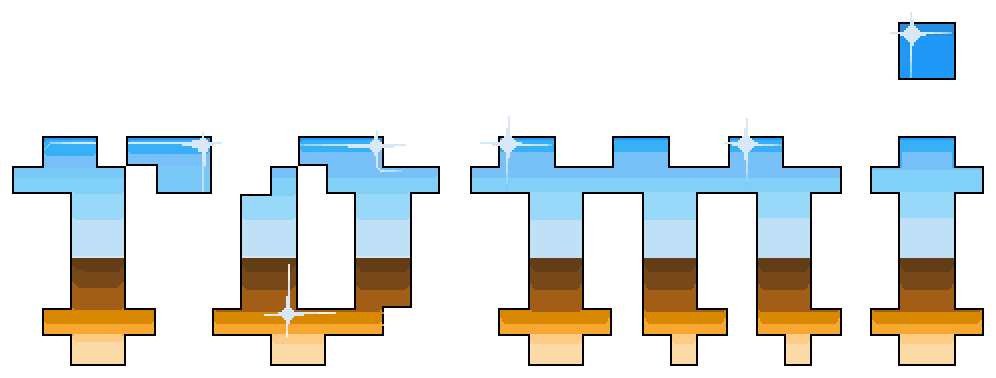

<h1 align="center">
  
</h1>

Play your games in your terminal. romi is a libretro frontend and game library: it runs emulator
cores itself and draws the game right inside its own interface, with sound, saves and
RetroAchievements, from the Game Boy to the PS2. Everything else you play (standalone emulators,
native ports, scripts, Steam) starts from the same list, with a keyboard or a controller.


<details>
<summary>Watch it with sound (27 seconds)</summary>

https://github.com/user-attachments/assets/3546be21-ad2e-4cfb-91fb-bc42bb2cdb4f

</details>

romi doesn't come with any games or cores: bring your own ROMs, the cores for the systems you play,
and BIOS files for the systems that need them.

## Play in your terminal

Press A on a game. A wireframe of the console builds itself in your terminal's colors, the camera
dives into its screen, and the game starts there, with the rest of romi still around it. No window
opens.

| System                                            | Core             | Notes                                 |
|---------------------------------------------------|------------------|---------------------------------------|
| Game Boy, Game Boy Color, Game Boy Advance        | mGBA             |                                       |
| NES                                               | Mesen            |                                       |
| Super Nintendo                                    | bsnes-hd         |                                       |
| Nintendo 64                                       | Mupen64Plus-Next | GPU                                   |
| GameCube                                          | Dolphin          | GPU, needs Dolphin's `Sys` folder     |
| Wii                                               | Dolphin          | GPU, a Wii Remote and Nunchuk on your pad |
| Nintendo DS                                       | melonDS          | Touch the screen with the mouse       |
| Genesis, Sega CD, Master System, Game Gear        | Genesis Plus GX  |                                       |
| Saturn                                            | Beetle Saturn    |                                       |
| Dreamcast, NAOMI                                  | Flycast          | GPU                                   |
| PlayStation                                       | Beetle PSX HW    | GPU                                   |
| PlayStation 2                                     | LRPS2            | GPU, [takes a little setup](docs/ps2.md) |
| PlayStation Portable                              | PPSSPP           | GPU                                   |
| PC Engine                                         | Beetle PCE Fast  |                                       |
| Arcade, Neo Geo                                   | FinalBurn Neo    | MAME's core plays arcade games too   |
| Neo Geo Pocket Color                              | Beetle NeoPop    |                                       |
| Atari Lynx                                        | Handy            |                                       |
| Atari 7800                                        | ProSystem        |                                       |

**You don't need RetroArch, only the core.** romi is the frontend: it loads the same `.so` files
RetroArch does, from your distro's `libretro-*` packages (and on Arch, the AUR's), or
[libretro's nightly builds](https://buildbot.libretro.com/nightly/linux/x86_64/latest/). Without
RetroArch, romi keeps everything in `~/.local/share/romi`: downloaded cores in `cores`, BIOS files in
`system`, and saves. If you do have RetroArch, romi uses its cores, BIOS folder, core options and
button remaps, and in-game saves carry on in either one. `romi check` says which folders it's using.

While you play:

- **RetroAchievements** unlock as you go, with badges, progress and rich presence. They count as
  softcore, and on GameCube and Wii an unlock hasn't been seen live yet.
- **Sharp 3D:** GPU cores draw about as big as they're shown, not at the console's 640×480.
- **Screen filters:** scanlines, CRT and LCD.
- **Save states:** ten slots for each game, with Select+R and Select+L on a controller or F2 and F4
  on a keyboard.
- **Controls** you can change per game or per system from its menu, with a controller for each
  player.

**A** plays a game in romi when it can, and **Play with** in its menu (`o`) starts its emulator
instead; Options → A plays turns that round. There's no rewind yet. More in
[Play in romi](docs/tui.md#play-in-romi) and [achievements](docs/achievements.md).

**PS2** runs on LRPS2, PCSX2's libretro core, which [takes a little setup](docs/ps2.md). romi falls back
to Play! (`libretro-play`) if that's all you have, but Play! runs far fewer games and isn't
recommended. PCSX2 is still there for anything else, in its own window.

## Everything else

- **One library.** Box art in a list or a cover grid, genres, years and player counts, fuzzy
  search, filters, your own tags, favorites, play time and a stats screen.
- **It starts the rest too.** Standalone emulators, native ports, scripts, `.desktop` launchers and
  Steam games are in the same list.
- **Controller first.** Everything works from a gamepad.
- **Sets itself up.** `romi init` finds your ROM folders, cores and emulators. `romi check` says
  what's missing or broken and how to fix it.
- **Scriptable.** `list`, `info`, `play` and `status` with JSON output and stable exit codes, for
  rofi, fzf, keybinds or coding agents. `romi run` boots a game headless with scripted input and
  saves a screenshot, the same every time.
- **Matches your theme.** It only uses your terminal's palette.

## Requirements

- **Linux**, x86_64 or aarch64.
- **Playing in the terminal** needs Ghostty or kitty. It takes Kitty graphics with Unicode
  placeholders, and it doesn't work in foot, Alacritty, Konsole or WezTerm, the others it's been
  tried in. Cores marked GPU above draw with OpenGL and need libEGL; Vulkan-only renderers won't
  start. They've been tested on one laptop so far: a Radeon 890M with Mesa, and an RTX 4060 for PS2.
- **In other terminals,** you still get the library, and A starts games in their emulators and says
  why. If yours can show them, **Play in romi** in a game's menu will still try. Box art is drawn with Kitty graphics, Sixel or iTerm2 images, or colored half-blocks where there
  are none.

## Install

**From a release:** download the tarball for your machine from the
[latest release](https://github.com/TitaniteScale/romi/releases/latest), and put `romi` on your
PATH:

```
tar -xzf romi-v*-x86_64-linux.tar.gz
install -Dm755 romi-v*-x86_64-linux/romi ~/.local/bin/romi
```

It needs `libudev` and ALSA's `libasound`, which nearly every desktop already has. For the newest
romi between releases, the [edge build](https://github.com/TitaniteScale/romi/releases/tag/edge) is
rebuilt from `main` after every change that passes the tests (`romi-edge-x86_64-linux.tar.gz`); it
may have bugs a release doesn't.
[Shell completions](docs/cli.md#completions) are set up with one line.

**On Arch,** build the package from a clone. It builds the latest release, and sets up shell
completions:

```
git clone https://github.com/TitaniteScale/romi
cd romi/packaging/arch
makepkg -si
```

**With Cargo,** with Rust installed, and a C compiler and the headers for udev and ALSA:

```
sudo apt install build-essential pkg-config libudev-dev libasound2-dev        # Debian, Ubuntu
sudo dnf install gcc pkgconf-pkg-config systemd-devel alsa-lib-devel          # Fedora
cargo install --locked romi
```

For the newest code on `main`: `cargo install --locked --git https://github.com/TitaniteScale/romi`.

## Getting started

Run `romi`. With no config yet, it first does what `romi init` does: it finds your ROM folders,
works out which system each is for, picks a core or emulator you have installed for each, and shows
what it found before writing anything. No ROMs yet is fine too: it starts with your Steam games and
anything you `romi add`. Rerun `romi init` after installing a core or adding a folder, and
`romi check` when something doesn't launch. More in [setting up](docs/setup.md).

```
romi           # open it
romi init      # find your ROMs, cores and emulators and write a config for them
romi add ~/Games/celeste   # add a native game, script or .desktop launcher
romi check     # what got found, what looks broken, and what could fix it
romi list      # every game as TSV: system, name, key (handy for rofi/fzf scripts)
romi info chrono trigger   # everything romi knows about one game
romi play super metroid    # start it in its emulator, from a script, a keybind, or another launcher
romi status    # what's running right now, and for how long
romi stats     # play time per system, most-played games, and this year month by month
romi achievements          # refresh your RetroAchievements progress, list games that have them
romi scrape    # find box art on disk, download the rest (or: romi scrape psx gba)
```

## Controls

| Keyboard          | Controller      | Does                                            |
|-------------------|-----------------|-------------------------------------------------|
| `j`/`k`, arrows   | d-pad, stick    | move (hold: speeds up after a second and a half) |
| `h`/`l`           | d-pad ←/→       | switch between systems and games                |
| `enter`           | A               | play (or open a system)                         |
| `esc`             | B               | back                                            |
| `tab`, `[` `]`    | LB / RB         | next / previous system                          |
| `ctrl-u`/`ctrl-d` |                 | page up / down                                  |
|                   | LT / RT         | previous / next letter                          |
| `f`               | Y               | favorite                                        |
| `r`               | X               | random game                                     |
| `d`               |                 | toggle details pane                             |
| `v`               | L3              | cover grid / list                               |
| `S`               | (menu)          | stats                                           |
| `A`               | (menu)          | achievements                                    |
| `/`               | Select          | fuzzy search everything                         |
| `F`               | R3              | filter by genre, players, decade, played, tag   |
| `s`               | (menu)          | sort: name, last played, most played, year      |
| `o`               | Start → game…   | the selected game's menu: favorite, hide, tags, emulator, achievements |
| `m`               | Start / Guide   | menu: the game's menu, search, filter, sort, random, cover grid, details, stats, achievements, show hidden, options, reload, quit |
| `ctrl-r`          |                 | reload config (it reloads by itself when saved) |
| `q`               |                 | quit                                            |

The controller is read directly, since terminals never see gamepad input, and ignored while a game
is running or the terminal isn't focused. [The launcher](docs/tui.md) covers the cover grid,
sorting, filters, tags, hiding games and picking another emulator.

## More

- [The launcher](docs/tui.md): the cover grid, sorting, filters, tags, hiding games, picking
  another emulator, and playing in romi
- [The command line](docs/cli.md): scripting with `list`, `info`, `play` and `status`, JSON, exit
  codes, completions, and running games headless with `romi run`
- [Config](docs/config.md): systems, commands, launch modes, overrides, hooks, BIOS checks,
  multi-disc games. [`default-config.jsonc`](default-config.jsonc) lists every option.
- [Achievements](docs/achievements.md): RetroAchievements and Steam
- [PS2 in romi](docs/ps2.md): LRPS2, Play! and PCSX2, setting it up, speed, saves, and which games work
- [Game info and box art](docs/game-info.md): where descriptions, genres and covers come from
- [Couch mode](docs/couch.md): for a PC plugged into a TV, open romi full screen from the
  controller's Guide button
- [Roadmap](ROADMAP.md): what's done and what's next
- [Working on romi](CONTRIBUTING.md): tests, releasing, and a map of the code
- [Credits](CREDITS.md): other people's work in this repository: the logo, by Andrea Reyes, and the
  3D models the launch animation is made from
